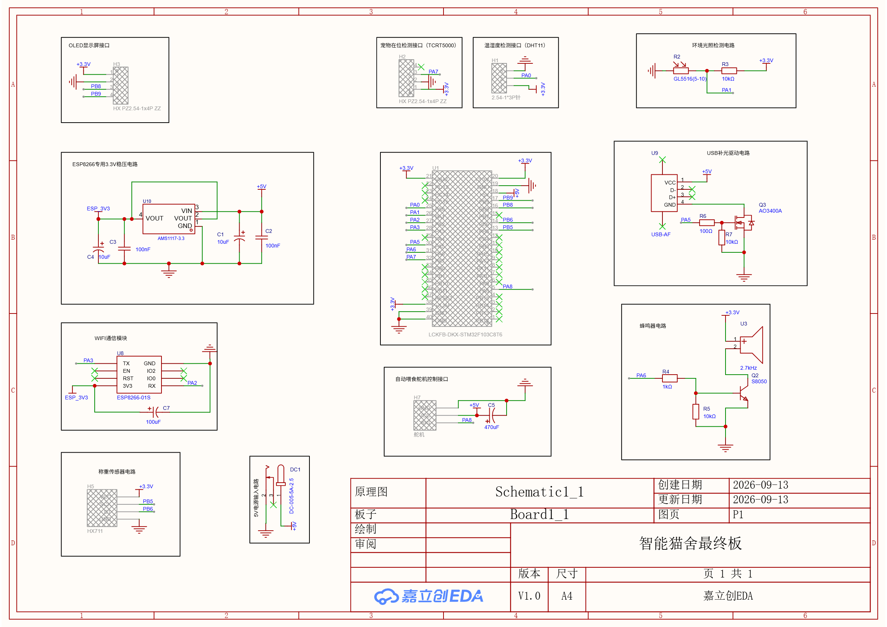

# STM32智能猫舍

基于STM32F103C8T6和HAL库开发的智能猫舍课程项目。目前已完成OLED显示、HX711称重和SG90舵机控制的软件集成，并完成DHT11驱动与故障隔离；后续继续加入环境检测、联网和自动控制功能。



## 项目特点

- 使用STM32CubeMX配置外设，基于HAL库开发。
- 每个功能模块独立封装为 `.c/.h`，`main.c`只负责初始化和任务调度。
- HX711加入超时、平均滤波、预热去皮、重量换算和零点死区。
- SG90使用TIM1硬件PWM控制，采用非阻塞状态机完成开关自检。
- DHT11使用DWT周期计数器实现微秒时序和校验和检查。
- 调试过程中区分编译、程序运行、电气接口、模块本体和机械结构，使用状态码与万用表逐层排错。

## 硬件组成

| 模块 | STM32接口 | 作用 |
|---|---|---|
| SSD1306 OLED | PB8 / PB9，I2C1 | 显示重量、温湿度和错误状态 |
| HX711 | PB5 SCK / PB6 DT | 读取压力传感器的24位ADC数据 |
| DHT11 | PA0 | 温湿度采集 |
| SG90舵机 | PA8 / TIM1_CH1 | 控制自动喂食机构 |

## 软件结构

```text
Core/
├─ Inc/
│  ├─ HX711.h
│  ├─ DHT11.h
│  ├─ Servo.h
│  └─ oled.h
└─ Src/
   ├─ HX711.c
   ├─ DHT11.c
   ├─ Servo.c
   ├─ oled.c
   └─ main.c
```

CubeMX生成的GPIO、I2C和TIM初始化代码负责底层外设配置；各模块文件负责具体功能，主函数负责组合和调度。

## HX711称重流程

```text
启动预热 → 多次采样平均 → 空载去皮 → 计算NET → 系数换算 → 零点死区 → OLED显示
```

- `RAW`：单次24位原始数据。
- `AVG`：多次采样平均值。
- `NET`：平均值减去空载零点。
- `WT`：NET除以标定系数后得到的重量。

当前实测同一物品多次测量约为1549～1558g，取下物品后可以回到0g。当前使用商家示例系数完成流程验证，正式精度仍需使用标准砝码重新标定。

## SG90舵机控制

PA8配置为TIM1通道1的PWM输出：

```text
TIM1时钟 = 36MHz
PSC = 35       → 计数频率1MHz，每个计数1μs
ARR = 19999    → PWM周期20ms，频率50Hz
CCR1 = 500～2500 → 映射0～180°
```

`Servo.c/.h`提供：

```c
Servo_Init();
Servo_SetAngle(angle);
Servo_OpenFeeder();
Servo_CloseFeeder();
```

舵机必须使用稳定5V供电，并与STM32共地，不能由STM32的3.3V引脚直接供电。

## 故障排查案例

DHT11运行后返回超时错误。排查过程为：

1. 检查PA0的CubeMX配置和驱动调用。
2. 核对最终原理图与PCB网络。
3. 实测主板接口与焊点供电约3.25V。
4. 将DATA与STM32断开，只保留模块供电。
5. DATA仍保持异常低电平，排除STM32程序拉低总线，最终定位为DHT11模块损坏。

该过程体现了按“现象 → 假设 → 控制变量实验 → 排除 → 结论”的方式定位软硬件故障。

## 当前状态

| 功能 | 软件状态 | 实物状态 |
|---|---|---|
| OLED | 已集成 | 已验证 |
| HX711称重 | 已完成 | 称重与回零已验证，精确系数待标准砝码标定 |
| DHT11 | 驱动已完成 | 原模块确认损坏，等待更换后验证 |
| SG90舵机 | PWM与模块封装已完成 | Keil编译通过，待烧录进行实物验证 |

## 构建环境

- MCU：STM32F103C8T6
- 配置工具：STM32CubeMX 6.18
- 固件库：STM32CubeF1 HAL 1.8.7
- IDE：Keil MDK-ARM 5
- 当前构建结果：`0 Error(s), 0 Warning(s)`

## 学习记录

- [开发日志 10.8](日志10.8.md)
- [舵机阶段日志 10.2](10.2.md)
- [模块与面试讲解](10.8.md)
- [舵机模块讲解](舵机模块.md)

